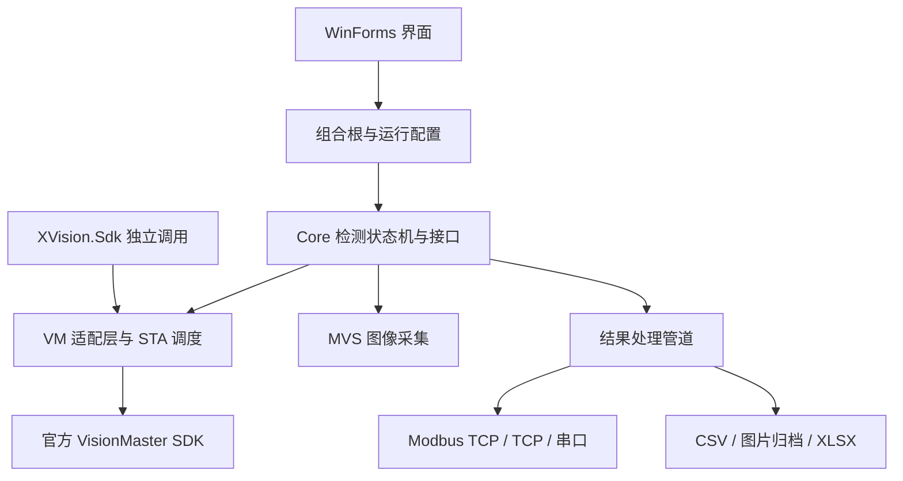
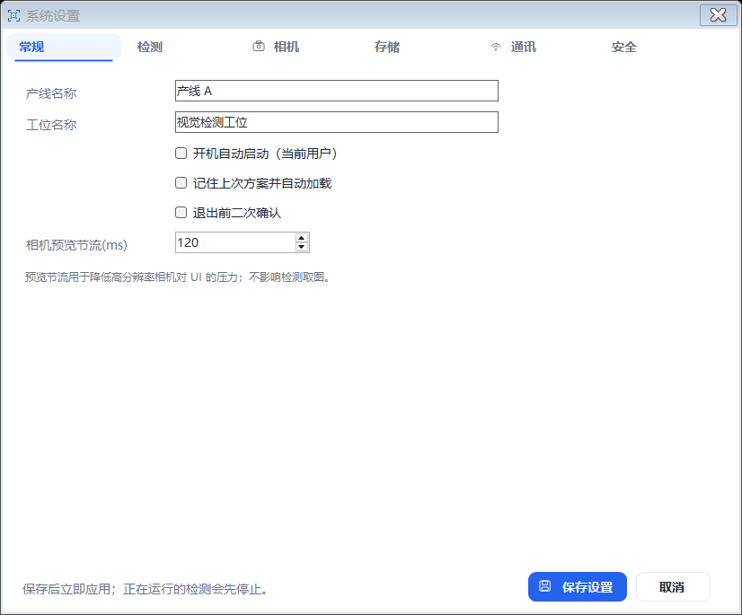
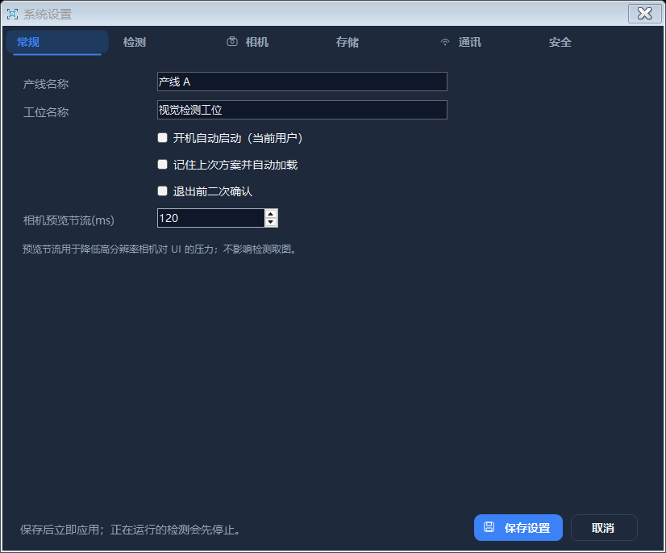

# X Vision

基于海康机器人 VisionMaster 4.3 SDK 的工业视觉检测上位机，使用 C# 与 WinForms 完成方案运行、图像显示、设备通讯和检测数据管理。

这是 VM 的二次开发项目：算法与 `.sol` 执行依赖海康运行库及有效许可。本仓库提供应用源码、自有 SDK 封装和测试入口，不包含海康 SDK 二进制文件、现场配方及客户数据。

**技术栈**：C# 7.3 · .NET Framework 4.7.2 · Windows x64 · WinForms / 嵌入式 VM 控件 · MVS · Modbus TCP · TCP · 串口

## 功能

| 范围 | 已实现内容 |
| --- | --- |
| 方案与检测 | `.sol` 加载/切换/保存，单次与连续检测，暂停/继续/停止，输出解析与 OK/NG 判定 |
| 图像输入 | 单张图片、整个文件夹导入，顺序/循环播放；MVS 相机枚举、连接、触发及参数写入 |
| 界面 | 日夜主题、图标式切换、自绘控件及统一 Logo，VM 原生图像和参数控件嵌入 |
| 通讯 | Modbus TCP FC03/FC16；TCP 主动连接/监听、结果模板；串口 ASCII/HEX；收发调试 |
| 配置 | 通讯独立于检测连接；业务配置应用后无需重启，失败报错并尝试恢复旧配置 |
| 数据 | 线程安全统计、有界异步图片归档、按日 CSV、无 Office 依赖的 XLSX 报表、审计日志 |
| SDK 与部署 | `XVision.Sdk` 独立调用、运行环境诊断、官方依赖检查和部署辅助脚本 |

## 快速开始

1. Windows x64 上安装 VS 2022 的“.NET 桌面开发”工作负载和 .NET Framework 4.7.2 开发包。
2. 安装官方 VisionMaster 4.3.0 开发环境及相机 SDK，并准备覆盖方案算法的有效 VM 授权。
3. 在仓库根目录使用 PowerShell 构建：

```powershell
.\scripts\Build.ps1 -Configuration Release `
  -VisionMasterRoot 'D:\Program Files\VisionMaster4.3.0' `
  -MvsSdkDir 'C:\Program Files (x86)\MVDAlgorithmSDK\ReferencedAssemblies'
& '.\src\VisionInspect.App\bin\Release\XVision.exe' '--data=D:\XVisionData'
```

首次运行生成本地配置。演示账号为 `admin / admin` 与 `operator / 123456`；部署前修改密码。当前管理员密码按本地配置明文保存，详见 [安全说明](SECURITY.md)。

在 VM 编辑器中验证自己的方案，打开 X Vision 后加载 `.sol`，导入本地图片并执行单次检测。相机与下位机联调前，先在本地图片模式确认方案输出、判定和数据记录。

详细路径配置和发布步骤见 [构建与部署](docs/DEPLOYMENT.md)。

## 架构



界面、检测流程、设备适配和存储分层；VM 对象交给专用 STA 线程及消息泵串行访问，结果处理与归档通过后台任务完成。主题切换保留原生渲染控件，配置在检测停止边界提交。

## 仓库导航

```text
VisionInspect.sln       解决方案，保留现有内部命名
src/                   Core、Infrastructure、VisionMaster、Cameras、Communication、App、XVision.Sdk
config/                脱离现场配置的示例
samples/               SDK 调用代码与合成图片
scripts/               构建、发布和回归入口
tests/                 回归测试程序
deployment/            环境检查与官方授权方式选择辅助脚本
docs/                  架构、操作、SDK、验证与已知边界
```

## 验证

不需要 VM 运行授权的核心与通讯基础回归：

```powershell
.\scripts\Test-Core.ps1 -Configuration Release
.\src\VisionInspect.Communication\Tests\Run-Regression.ps1 -Configuration Release
```

完整 GUI、SDK 与集成测试需要本机官方 SDK；真实算法测试还需要有效许可。已保留 2026-11-09 的验证记录，另在本次仓库整理中重新验证构建和基础回归；具体结果见 [验证矩阵](docs/VERIFICATION.md)。GitHub Actions 仅执行无需海康库的核心与通讯基础回归，完整软件不能在没有官方 SDK 的环境中构建。

## 使用范围

- 当前视觉引擎为 VM，不包含 OpenCV 集成或自研替代算法。
- Modbus 仅实现 TCP FC03/FC16；串口通道不等于 Modbus RTU。
- 本机模拟端点测试不能替代现场 PLC、串口设备和工业相机验收。
- 当前成功执行记录基于 USB 授权；无 USB 运行仍需合适的官方授权并另行验证。
- 日夜切换已有连续 20 次回归记录；未作零故障或所有负载下零卡顿承诺。

## 文档

- [架构与线程模型](docs/ARCHITECTURE.md)
- [操作指南](docs/USER_GUIDE.md)
- [通讯与配置即时应用](docs/COMMUNICATION_LIVE_SETTINGS.md)
- [SDK 与运行授权](docs/SDK_RUNTIME_DEPLOYMENT.md)
- [主题切换透明覆盖层问题复盘](docs/THEME_OVERLAY_FIX.md)
- [第三方依赖与许可边界](THIRD_PARTY_NOTICES.md)

仓库展示源码，不预设开源许可；未附许可证的使用权限不因源码可见而扩大。第三方算法、商标及运行库遵循其各自条款。

## 界面预览

以下为隔离测试配置下的真实设置窗体。主界面操作和原生图像显示验证见验证矩阵。

| 白天 | 夜间 |
| --- | --- |
|  |  |
