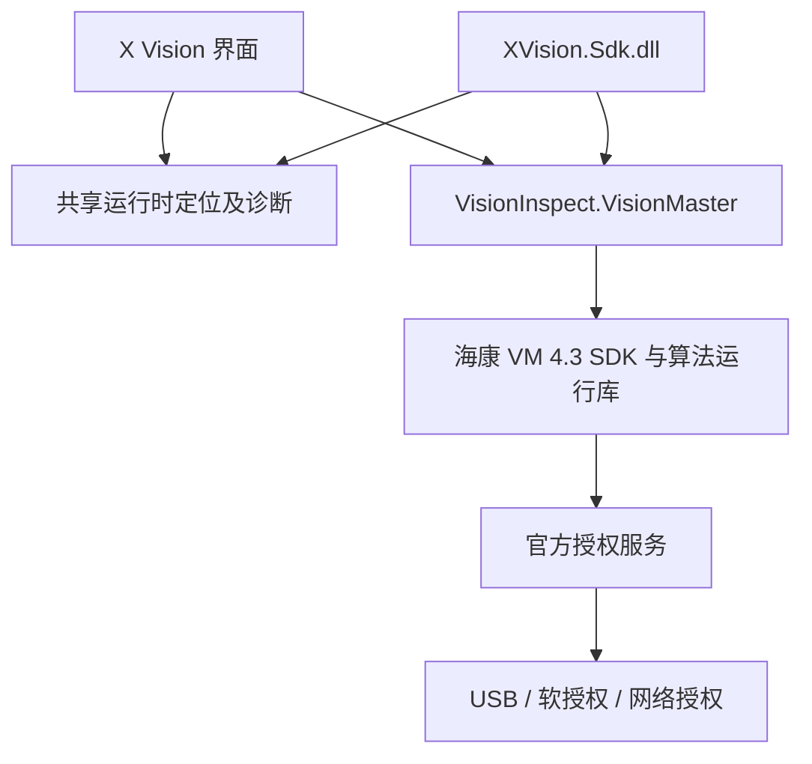

# X Vision SDK 与无 USB 加密狗部署方案

更新日期：2026-11-09。当前目标是继续使用海康 VM 作为底层算法，通过 X Vision 界面或独立 SDK 加载 `.sol`，无需打开 VM 编辑器界面；生产机无 USB 加密狗的部署采用适配的官方软授权。

## 已确认的边界

二次开发不会将 VM 的算法实现及其运行许可变成 X Vision 自有的免授权算法。`.sol` 是方案及参数，仍需要对应 VM 运行库执行。SDK 包装、相机驱动和授权驱动各自负责不同功能，安装驱动不会生成或迁移许可。

本机官方配置 `Applications/Server/ServerAuthConfig.ini` 当前为 `AuthorizeType = 0`（本机 USB 授权）。本机安装的 VM 4.3 帮助说明支持软授权的在线和离线激活；SDK 实际能否执行目标方案，必须核对许可覆盖的版本、算法、相机能力及 SDK 使用范围并实测。

用户当前只有 USB 加密狗，尚未提供官方软授权。因此本次交付完成 SDK、诊断和部署工具；**不将“无 USB 狗执行方案”标记为已实现或已验收**。现有 USB 许可是否可以迁移、需要什么软授权，应由海康确认。

官方资料：

- [VM 官方产品与 SDK 开发说明](https://www.hikrobotics.com/en/machinevision/visionmaster/)
- 本机安装帮助“通过授权码”：`D:/Program Files/VisionMaster4.3.0/Applications/Help/CH/GUID-212BAC83-63F2-46F9-BB50-0153ACE6B9B4.html`。
- 本机官方 `ServerAuthConfig.ini` 头部定义了授权模式：0 本机狗、1 Sentinel 软授权、2 Virbox 软授权、3 网络授权、4 Virbox 多方式检测。这里只是选择已有授权的校验方式。

## 软件结构



GUI 与 SDK 共用运行时定位代码，统一 x64、.NET Framework 4.7.2、程序集解析及 SDK 串行调度。SDK 不依赖 `XVision.exe`，不会启动 X Vision 的通信连接、账号系统或业务界面。GUI 保留原有项目与配置。

主界面新增“运行环境”，可只读检查目录、所需程序集、已配置授权方式并导出诊断，也可打开海康官方软授权工具。`XVision.exe --runtime-check` 可直接进入该页面。诊断明确区分“找到了文件”和“实际许可已经验证”，不会仅根据驱动或文件存在宣称激活。

## SDK 使用

SDK 版本 1.0.0，目标 Windows x64 / .NET Framework 4.7.2。引用 `lib/net472` 中三个自有程序集：

- `XVision.Sdk.dll`
- `VisionInspect.Core.dll`
- `VisionInspect.VisionMaster.dll`

运行机器安装匹配版本的官方 VM 环境。授权方式由官方运行时处理，SDK 没有强制插 USB 狗的应用级判断。基础用法：

```csharp
using (var client = XVisionClient.Create(new XVisionSdkOptions {
    VisionMasterDirectory = @"D:\Program Files\VisionMaster4.3.0",
    ParameterDirectory = @"D:\XVisionData\parameters"
})) {
    await client.LoadAsync(@"D:\Projects\inspect.sol");
    var result = await client.InspectAsync(RawImage.FromFile(@"D:\Images\part.bmp"));
    Console.WriteLine(result.JudgeText);
}
```

公开接口还包括 `InspectFileAsync`、`SaveAsync`、`UnloadAsync`、`GetParametersAsync`、`SetParameterAsync`、`ShutdownAsync`。对象内部串行管理加载、执行和卸载；底层 `VisionSdkException.ErrorCode` 保留原始错误码。授权不可用时返回明确的授权失败。

建议使用绝对文件路径。SDK 的相对方案及图片路径按创建客户端时保存的 `BaseDirectory` 解析；可显式传入该目录。VM 运行时初始化会调整本进程的当前工作目录以解析原生依赖，宿主程序自己的文件操作应使用绝对路径。

包内 `sample/XVisionSdkSample.exe` 为独立调用示例：

```text
XVisionSdkSample.exe <VM安装目录> <方案.sol> <图片文件>
```

示例会实际运行所选方案，请先在脱离生产设备的环境验证方案内容；SDK 不是 `.sol` 的隔离沙箱。示例退出码 3 表示官方授权错误。

## 运行时和驱动部署

`deployment/Runtime-Check.cmd` 默认只检查环境，JSON 报告不包含许可码或加密狗序列号。脚本用 64 位 PowerShell 执行。

```powershell
.\deployment\Install-XVisionRuntime.ps1 -Action Check
.\deployment\Install-XVisionRuntime.ps1 -Action InstallMissing -VisionMasterRoot 'D:\Program Files\VisionMaster4.3.0'
```

`InstallMissing` 仅在缺少依赖时启动经过数字签名验证的官方安装器；Windows 安装权限由 UAC 提示处理。相机组件用 `-WithCamera` 显式选择。没有 VM 环境时，需通过 `-OfficialVmInstaller` 提供匹配的官方完整安装包。包内不以零散 DLL 代替官方 VM 安装器，不自动运行旧版总安装批处理，不修改全局授权模式。

本机已安装 .NET Framework 和 SenseShield 服务，运行库检查没有缺失项，因此本次没有重装驱动或服务。

## 无 USB 狗交付流程

1. 由海康确认现有许可迁移方案，取得覆盖项目实际算法和 SDK 使用的官方软授权。
2. 打开官方 `SoftEncryptActive.exe`，按授权类型在线激活或使用本机 C2D / D2C 流程离线激活；许可应对应目标机器。
3. 在维护窗口退出 X Vision、VM 及其运行时进程，按官方要求选择软授权并重新启动运行时。随包提供的选择脚本会备份原配置、拒绝未明确确认的修改，支持 `-WhatIf` 预览。
4. 拔除工作站 USB 加密狗，在该机器实际加载目标 `.sol`，检查模块、算法执行、图像显示、相机和通信，并重启后再验收一次。

仅在已经取得对应许可时，由管理员明确执行：

```powershell
.\deployment\Set-VmAuthorizationMode.ps1 -VisionMasterRoot 'D:\Program Files\VisionMaster4.3.0' -Mode Soft -OfficialLicenseConfirmed -WhatIf
```

预览无误后移除 `-WhatIf`。该操作只选择官方校验方式，不能将 USB 许可转换成软许可；激活状态仍需实际运行验证。授权方式属于底层运行时初始化条件，按官方要求重启；既有检测、通信、存储等业务参数的即时应用保持不变。

## 本轮验证记录

- 实际 SDK 冷探测曾返回 `0xE0000700`，记录了许可缺失/检测异常路径。
- 随后系统检测到 `SenseShield Elite5 3.X` USB 授权设备，官方配置仍是模式 0。在这个条件下，独立 SDK 完成了官方方案加载、图像输入、运行、输出、保存、并行请求卸载的串行处理及释放；示例目录没有 `XVision.exe`。
- 软授权模式的文件检查不被当成已激活；错误提示保留原始错误码并区分授权和驱动问题。
- 授权方式脚本在独立模拟目录验证了确认保护、预览、备份、保留其他字段和拒绝歧义配置；真实 VM 配置未改写。
- 诊断页面日夜主题通过绘图检查。

USB 条件下的成功不代表无 USB 已验收。当前未完成“官方软授权 + 无 USB”实机加载和算法运行，待有效软授权就绪后完成。
